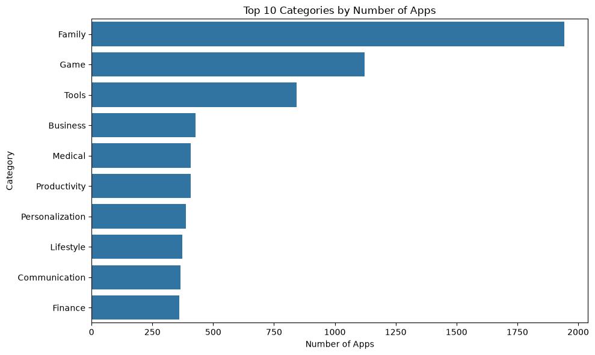
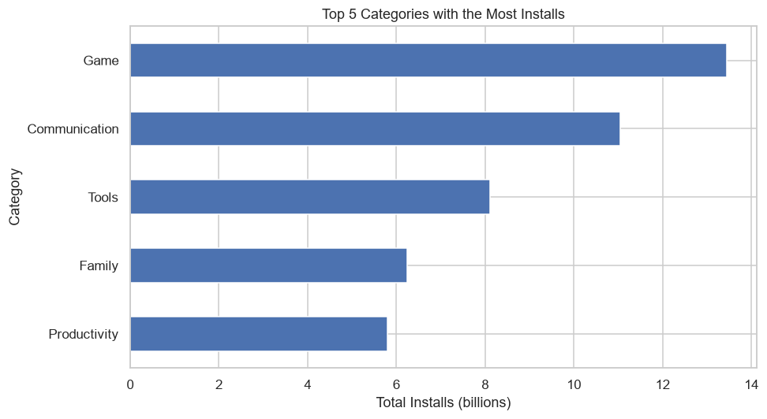
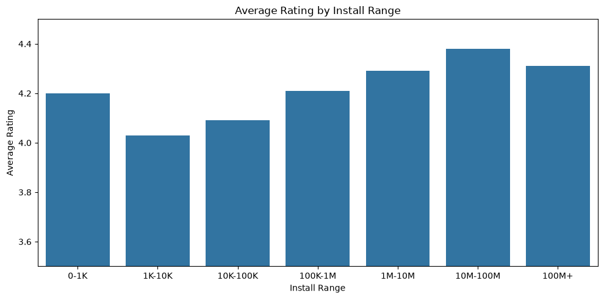
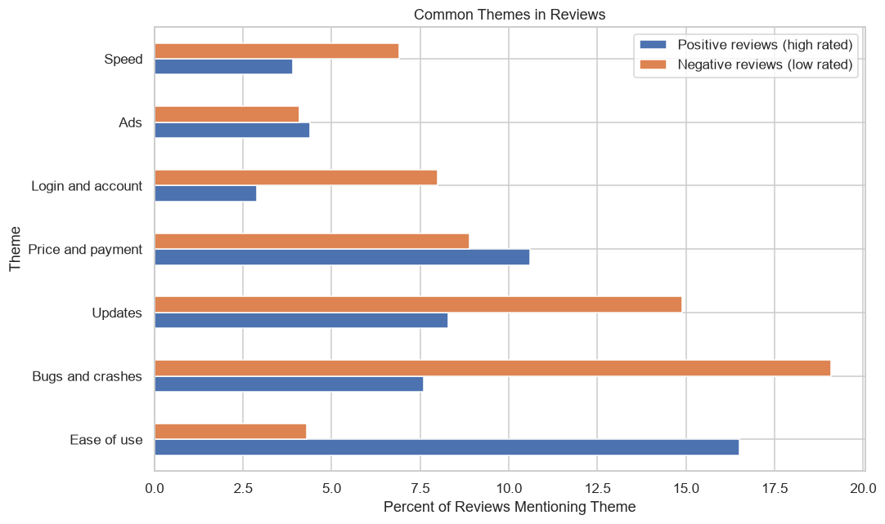

# Google Play Store EDA

Exploratory Data Analysis (EDA) of around 10,000 apps from the Google Play Store using Python.

I wanted to find out what actually makes an app successful on the Play Store. Is it the category, the price, the size, how often it gets updated? To answer that, I cleaned the raw data and worked through 25 questions, from basic counts to sentiment analysis of user reviews.

## Dataset

[Google Play Store Apps on Kaggle](https://www.kaggle.com/datasets/lava18/google-play-store-apps)

Two files are used:

* `googleplaystore.csv`: 10,841 apps with category, rating, reviews, size, installs, price, content rating, genre and last updated date
* `googleplaystore_user_reviews.csv`: 64,295 user reviews with a sentiment label (Positive, Negative, Neutral)

The data was collected in August 2018, so all results are as of that time.

## Tools

* Python
* Pandas and NumPy for cleaning and analysis
* Matplotlib and Seaborn for charts
* Kaggle Notebook

## Data Cleaning

I kept the cleaning light so the data stays close to the original.

* Removed extra spaces and hidden characters from all columns
* Dropped 1 broken row where the values were shifted by one column
* Removed 483 exact duplicate rows (10,357 rows left)
* Converted Installs, Price, Reviews and Rating to numbers, and Last Updated to a date
* Converted Size to MB. Apps with size "Varies with device" were left blank instead of guessing a value
* Filled 1 missing Type as "Free" because its price was 0
* Left the 1,465 missing ratings blank. These are mostly very new or small apps, so filling them with an average would have changed the results
* Added a few helper columns like a clean category name, primary genre, year, and range groups for size, price and installs

Some apps still appear more than once because they were collected at different times or listed in two categories. I used the full cleaned data for most questions, and a one row per app table (9,659 apps) only for the top N lists and for summing installs, so the same app is not counted twice.

For the reviews file, I removed rows with no review text and 7,735 duplicate reviews, which left 29,692 reviews.

## Questions Explored

**Basic**
1. Average rating of apps
2. Number of unique categories
3. Distribution of app sizes
4. Free vs paid apps
5. Most common content rating
6. Top 5 most installed apps
7. Apps with a rating of 4.0 and above
8. Average reviews for free vs paid apps
9. Average app size by category
10. Apps last updated in 2018

**Medium**
1. Correlation between installs and rating
2. Categories with the highest average rating
3. Effect of price on rating
4. Rating distribution across content ratings
5. Genres with the most apps over 1 million installs
6. How often apps get updated
7. Impact of app size on installs
8. Most reviewed apps and their ratings
9. Content rating for free vs paid apps
10. Top 5 categories by installs

**Advanced**
1. Top 10 highest rated apps compared with their reviews and installs
2. Trend and seasonal patterns in app updates
3. Average rating across install ranges (binned analysis)
4. Sentiment analysis and common themes in reviews of high and low rated apps
5. Relationship between genre and rating

## Key Findings

* **Most apps are free.** 92.6% of apps are free and 80.9% are rated Everyone.
* **Ratings are generally high.** The average rating is 4.19, and 78.1% of rated apps have 4.0 or above.
* **Games and messaging lead in installs.** Game (13.45B), Communication (11.04B) and Tools (8.10B) have the most installs. The top 5 categories make up 59.2% of all installs.
* **Popular does not always mean better rated.** The correlation between installs and rating is only 0.051. Ratings do go up a little with installs, from 4.03 for apps with 1K to 10K installs to 4.38 for apps with 10M to 100M installs.
* **Price barely matters until it gets high.** Paid apps under 20 dollars average about 4.25, but apps over 50 dollars drop to 3.91.
* **Free apps get far more engagement.** Free apps get about 37 times more reviews on average than paid apps.
* **Bigger apps tend to have more installs.** Apps between 50 and 100 MB have a median of 1M installs, compared with 10K for apps under 10 MB.
* **Perfect ratings come from small apps.** 271 apps have a 5.0 rating, but none of them has more than 141 reviews.
* **What users like and dislike.** Positive reviews of high rated apps mostly talk about ease of use. Negative reviews of low rated apps mostly mention bugs, crashes and problems after updates.

## Charts

All charts from the notebook are in the [images](images) folder.

## Recommendations

1. Focus on free apps in high demand categories like Game, Communication and Tools, and earn through ads or in app purchases.
2. Keep the app simple and easy to use. This is what users praise most in high rated apps.
3. Test updates properly and fix bugs quickly. Crashes and broken updates are the most common complaints in low rated apps.
4. Update the app regularly. 63.3% of apps were updated within the last 6 months of the data.
5. Keep paid apps at a fair price, since very expensive apps get lower ratings.

## Limitations

* The data is from 2018 and installs are given as ranges (like 1,000,000+), not exact numbers.
* Each app has only its latest update date, so update frequency could only be measured for 42 apps.

## How to Run

Install the libraries with `pip install -r requirements.txt`, download the dataset from the Kaggle link above, and run the notebook. You can also view it directly on [Kaggle](https://www.kaggle.com/code/manishamali/eda-google-play-store).
